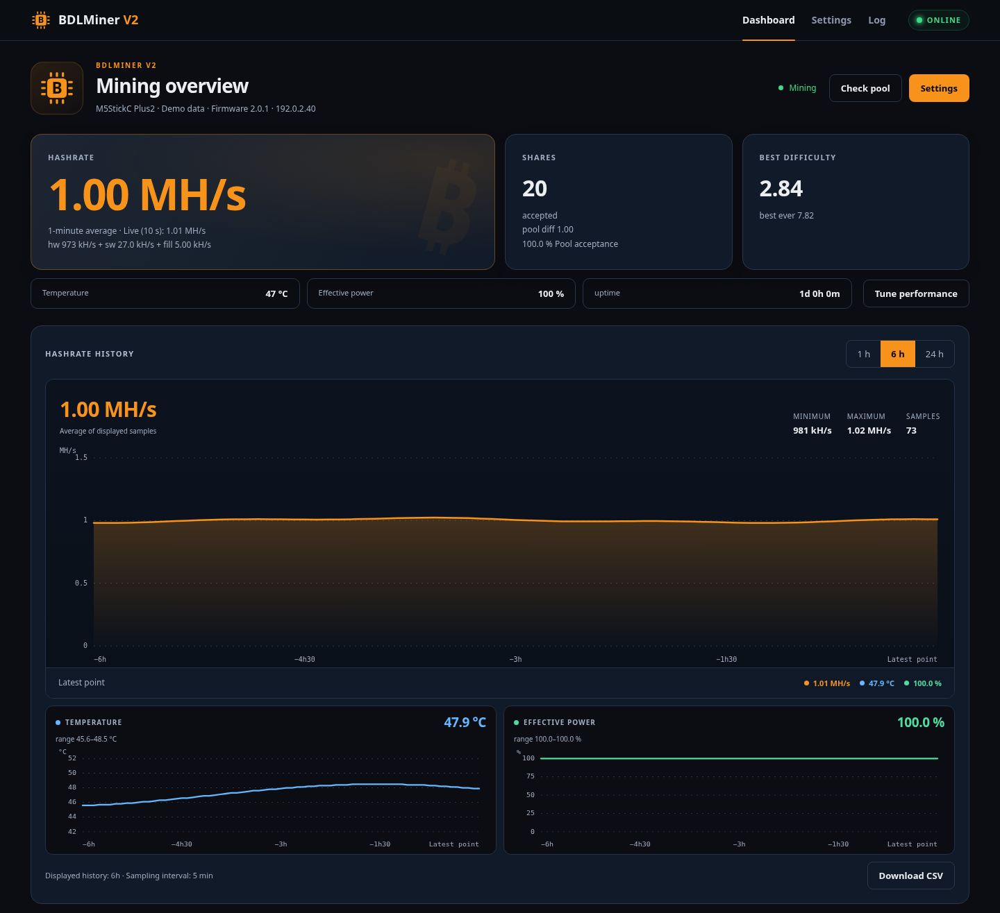
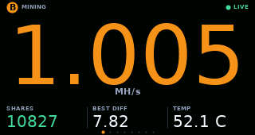
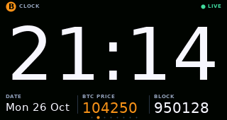
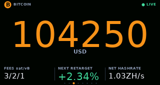
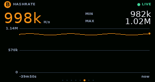

# BDLMiner V2

Solo SHA-256d mining firmware for ESP32 boards and experimental ASIC boards,
with a local dashboard and a Linux/Raspberry Pi fleet hub.

**[Flasher](https://bdlglua.github.io/flash.html)** ·
[Website](https://bdlglua.github.io/) ·
[Interactive demos](https://bdlglua.github.io/demo.html) ·
[Statistics](https://bdlglua.github.io/stats.html) ·
**[Stable v2.5.2](https://github.com/bdlglua/BDLMinerV2/releases/tag/v2.5.2)**

Mine **BTC, BCH, BSV, eCash (XEC), DigiByte SHA-256d (DGB) or Peercoin (PPC, PoW)** with a matching
pool and payout address or account. BTC supports Stratum V1 and native Stratum V2.
All other profiles use Stratum V1. Match the primary and backup pools to the
selected chain. DGB requires a SHA-256d endpoint, and PPC supports proof-of-work
mining only. [Coin and pool setup](docs/mining-coins.md).

*Dashboard preview with demo data.*

On-device screen previews (demo data)

| Mining | Clock |
| :---: | :---: |
|  |  |
| **Bitcoin network** | **Hashrate history** |
|  |  |

## Features

- Live dashboard, charts, settings, backups, pool diagnostics and multi-miner hub.
- Eight physical screens, English/French, themes, rotation and night mode.
- Signed stable/beta updates with trial boot and automatic rollback.
- Notifications, Home Assistant/MQTT, JSON API and Prometheus metrics.
- Optional, read-only [private remote monitoring](docs/remote-access.md), off by
  default and independent of public statistics. Paired miners report about every
  five minutes over verified HTTPS, with seven days of history and no local hub.
- Outbound HTTPS verifies the server certificate chain and hostname. Signed
  GitHub updates have a limited transport exception. See [Security](SECURITY.md).

## Install and update

1. Open the **[Flasher](https://bdlglua.github.io/flash.html)** in Chrome or Edge
   on a computer. Connect your board with a data USB cable and select **Flash**.
   **First installation erases the board.** Read the ASIC board guide first.
2. Join **`BDLMinerV2-XXXX`**, password **`MineYourCoins`**, then open
   **http://192.168.4.1**. Set Wi-Fi, cryptocurrency, matching pool and payout
   address or pool account.
3. Open the local dashboard at the IP shown on the screen/serial monitor, or
   **http://bdlminer-xxxx.local/**.

Already installed? Use automatic signed updates or upload the matching
`<board>-firmware.bin` from the local dashboard.
[Installation and update guide](docs/guide.md#install-a-release-no-build-tools).

## Supported boards

| Family | Boards |
|---|---|
| M5Stack ESP32 | M5StickC Plus2, StickC/Plus, Core/Core2, Tough, Atom, Stamp Pico |
| M5Stack ESP32-S3 | Cardputer/ADV, StickS3, CoreS3, AtomS3, Dial, DinMeter, StampS3 |
| LilyGO | T-Display, T-Display-S3 |
| Other ESP32 | Cheap Yellow Display; headless ESP32, S2, S3 and C3 |
| ASIC — experimental | [Bitaxe Gamma 601 (BM1370)](docs/hardware/bitaxe-gamma-601.md), [NerdNOS (BM1397)](docs/hardware/nerdnos.md) |

[Full board/environment list](docs/hardware/supported-boards.md) ·
[Measured comparison](https://bdlglua.github.io/boards.html) ·
[Hardware validation and limits](docs/v2/hardware-validation.md)

M5StickC Plus2 and Gamma 601 have owner-operated V2 measurements. Physical V2
measurements for S2/S3/C3 and NerdNOS, and tests on the BSV/XEC/DGB/PPC pools,
remain pending. Hashrate depends on the board; 1 MH/s is not a rating for every ESP32.
Solo mining is educational: a payout requires finding a valid block.

## Documentation

- [User guide](docs/guide.md) · [V2 hub and setup](docs/v2/README.md)
- [My miners remotely](https://bdlglua.github.io/remote/) · [Private setup](docs/remote-access.md) / [Français](docs/remote-access.fr.md)
- [Troubleshooting FAQ](https://bdlglua.github.io/faq.html) · [Shares explained](docs/guide.md#pool-shares-and-local-records)
- [Coin and pool setup](docs/mining-coins.md)
- [Stable v2.5.2 release notes](docs/releases/v2.5.2.md) / [Français](docs/releases/v2.5.2.fr.md) · [All releases](https://github.com/bdlglua/BDLMinerV2/releases)
- [Build from source](docs/development.md) · [Contribute](CONTRIBUTING.md) · [Security](SECURITY.md)

### Pools for ESP32

For BTC, start with a low-difficulty pool.
[Endpoints, protocols and user agents](docs/pools.md).
For other coins, follow the [coin-specific requirements](docs/mining-coins.md).

## Privacy

### Anonymous usage count

Enabled by default; disable **Anonymous usage count** in Network settings.
[What is counted](docs/anonymous-statistics.md#anonymous-usage-count).

### Anonymous hashrate sharing

Hashrate and public pool-group sharing are enabled by default; both can be disabled
in Network settings, and saved disabled choices are kept. Reports include board,
version and coin, but no payout address, worker, private hostname or miner identifier.
[Data, controls and retention](docs/anonymous-statistics.md#anonymous-hashrate-sharing).

## Community and license

[Discord](https://discord.gg/S8kSgD6Xe9) ·
[Report a bug](https://github.com/bdlglua/BDLMinerV2/issues/new/choose) ·
[Support BDLMiner](https://github.com/sponsors/bdlglua)

Free software under the **[GNU GPL v3.0](LICENSE)**.
[Credits and upstream projects](docs/credits.md).
