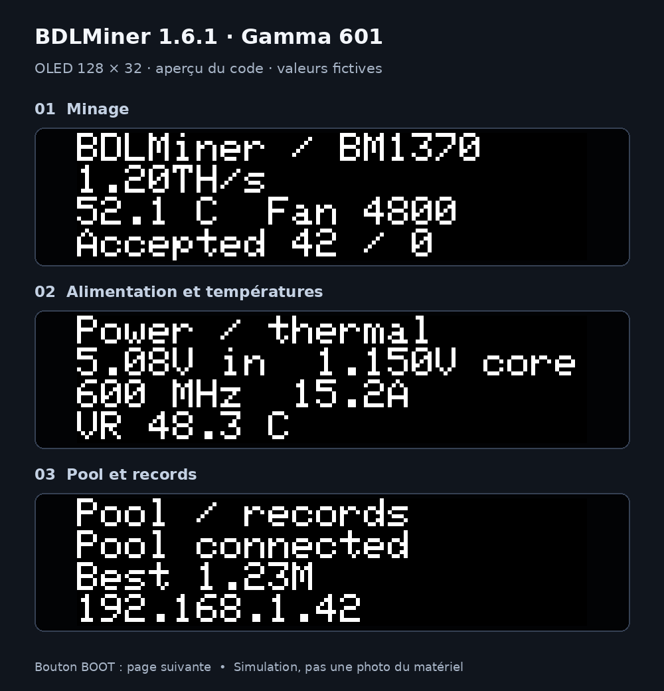

# Bitaxe Gamma 601 — experimental native BDLMiner

This target replaces AxeOS. It drives the single BM1370; it does not use software
SHA on the ESP32 as a substitute. **No physical Gamma 601 was available during
implementation. Electrical behavior, real hashrate and accepted pool shares still
need validation on a board.** Do not interpret simulated TH/s tests as measurements.

### OLED preview (v1.6.1)

The three pages below use the firmware's 128×32 monochrome rendering and font,
enlarged for readability. **All values are fictional demo data**, not hardware
measurements. Press BOOT to switch pages.



## Supported hardware

Only revision **601**, ESP32-S3-WROOM-1 **N16R8** (16 MB flash / 8 MB octal PSRAM),
one BM1370, TPS546D24A/S, EMC2101, 128×32 SSD1306 OLED at 0x3c.

| Function | Pins / bus |
|---|---|
| ASIC UART1 | TX GPIO17, RX GPIO18; 115200 initialization, 1000000 mining |
| ASIC reset | GPIO1, active low |
| I2C0 shared with OLED | SDA GPIO47, SCL GPIO48, 400 kHz |
| TPS546 / EMC2101 / OLED | 0x24 / 0x4c / 0x3c |
| BOOT / screen button | GPIO0 |

Use a regulated **5 V barrel supply rated for at least 4 A** (preferably 25–30 W),
a properly mounted heatsink and the 5 V 4-pin PWM fan. For the 600 MHz profile,
prefer a 5 V / 6 A (30 W) supply for headroom. USB-C provides programming;
USB alone is insufficient for ASIC mining. This target must not be flashed onto a
Gamma Turbo, Hex, Supra, another Gamma revision, or a generic ESP32-S3.

## Build and install

1. Save your AxeOS settings and pool/worker configuration. If you need an exact
   rollback, back up the flash with esptool before erasing it. BDLMiner does not
   import AxeOS NVS settings.
2. Download **`bitaxe-gamma-601-factory.bin`** from the
   [v1.9.6 release](https://github.com/bdlglua/BDLMinerV1/releases/tag/v1.9.6) and
   flash it at **0x0** over USB, or select **Bitaxe Gamma 601 (experimental)** in
   the [web flasher](https://bdlglua.github.io/BDLMinerV1/).
   Alternatively, build with PlatformIO 6.1.19:

   ```sh
   pio run -e bitaxe-gamma-601
   pio run -e bitaxe-gamma-601 -t upload
   pio device monitor -b 115200
   ```

   If USB is not detected, hold BOOT while reconnecting USB, then release BOOT.
   Factory flashing erases settings/statistics. Existing BDLMiner installations
   can use the matching signed `bitaxe-gamma-601-firmware.bin` for OTA.
   CI artifacts remain unsigned development builds for USB testing.
   A packaged factory image is flashed at **0x0**; the app-only
   `firmware.bin` is not a complete image for offset 0.
3. Connect to `BDLMinerV1-XXXX`, password `MineYourCoins`, and open
   `http://192.168.4.1`. Set WiFi, your payout address/worker, and a web password.
4. Defaults are `public-pool.io:3333`, Stratum V1, suggested difficulty **1024**,
   automatic BDLMiner user agent. The pool must accept BIP310 version rolling
   (>=8 bits) and difficulty **>=16**. ESP32-only low-difficulty ports such as 21496
   are unsuitable for this ASIC target. A refused/unsupported pool keeps the ASIC
   off and shows the requirement in the dashboard.
5. Open the miner's local IP. Check **ASIC · BM1370**, fan RPM, input/core voltage,
   regulator temperature and the physical ASIC temperature. A connected pool alone
   does not mean the ASIC is mining. Establish accepted shares before unattended use.

Do not select Stratum V2 for Public Pool's V1 endpoint. V2 is available through the
existing authenticated V2 client only when the chosen server supports extended
jobs, permits version rolling and supplies an appropriate authority key/target.

To restore AxeOS, use the official Bitaxe/AxeOS USB flashing procedure with the
**601** board configuration or your saved complete flash backup. This changes the
partition layout; do not try to upload an AxeOS app through BDLMiner's OTA form.

## Controls, telemetry and safety

* Since v1.6.1, the firmware defaults to an **experimental 600 MHz profile** at
  **1150 mV**. Since v1.6.2, local Settings > Safety offers
  **525–800 MHz in 25 MHz steps** (v1.6.1 only offers 525 / 550 / 575 / 600 MHz);
  changes apply after restart and are included in backups. Older Gamma settings
  without this new key inherit the requested 600 MHz default. Invalid stored profile
  values fall back to 525 MHz; API requests outside the available profiles are rejected.
* Mining power 10–100% scales the selected profile (minimum 50 MHz); 0 pauses.
  Values 1–9 keep the ASIC off with an explanatory status. The fan remains **100%**.
  Thermal limiting may reduce the actual frequency below the requested profile.
* Three consecutive ten-second hardware-error windows at **>=2%**, a missing/stalled
  hash counter, or unavailable hardware-error telemetry trigger a reset/power-off and
  one restart at **525 MHz** when running above stock. The fallback stays active across
  pool reconnects and ordinary pauses until the next reboot; it never raises voltage.
  A failure at stock still stops mining. Temperature/fan/supply/sensor faults keep
  their latched shutdown behavior and never use this retry path.
* The dashboard shows requested/actual frequency, measured hardware-error percentage
  (unavailable until a complete window), fallback state and its reason. Rates still
  come from the physical hash counter, not from clock settings. **Overclock profiles,
  including 600 and 800 MHz, have not been validated on a physical Gamma 601.**
  The 800 MHz setting does not guarantee stability at the fixed 1150 mV; no voltage,
  current, temperature or fan limits are raised to reach the requested frequency.
* BOOT short press cycles the three compact OLED pages; a long press follows the
  existing reset/setup behavior. OLED rotation maps 0/1 to normal and 2/3 to 180°.
* No ASIC power during provisioning. Startup checks device identities and verifies
  volatile PMBus writes. VOUT warning/fault/margin registers are programmed as
  ratios of `VOUT_COMMAND`, while command/min/max registers use absolute voltage.
  **No regulator NVM/STORE commands are sent.**
* The user thermal limit (default 65°C) still throttles/pauses mining. Independent
  hard interlocks stop at **70°C ASIC**, **90°C regulator**, lost sensors, fan
  <500 RPM, input outside **4.8–5.5 V**, core voltage outside **1.0–1.25 V** while
  powered, output current >=30 A or regulator faults. Hard limits remain active
  even if the user temperature setting is disabled. Faults latch until restart.
* Startup waits 500 ms for core power stabilization, then ramps the PLL in
  6.25 MHz steps spaced by 100 ms, following ESP-Miner. Fan, voltage/current and
  regulator temperature are sampled throughout startup after the power-good grace
  period; the ASIC diode is required once its mux/conversion has settled. The ramp
  responds to live power limits and stops on faults, stale work or expired permission.
* Reset is asserted **before** the I2C power-off command. On a failed I2C shutdown,
  the dashboard explicitly reports a shutdown fault; remove power and investigate.
* The ASIC task checks the existing three-second supervision lease and OTA state.
  Pauses/connection loss/clean jobs invalidate outstanding work and stop the ASIC.
  Sensor sampling continues during ordinary pauses so cooldown can be observed.
* Returned nonces are CRC checked, mapped to a bounded work-slot cache, screened
  for duplicates and independently double-hashed on the ESP32 before submission.
  Negotiated version masks apply to both V1 and V2; stale generations are discarded.
* Hashrate comes from the ASIC's 0x8c counter in units of 2^32 hashes, not from the
  configured clock. Counts, rate windows and dashboard history support TH/s.
  The first counter response establishes the baseline; missing replies or a stalled
  counter stop mining.
* Local difficulty records are sampled from ASIC results (minimum difficulty 16),
  rather than all difficulty-1 candidates. Pool shares still use the assigned target.
* Automatic GitHub installation defaults to **check/offer** on this experimental
  target. Existing published releases do not acquire a Gamma binary retroactively.

## Validation before calling this support stable

Host tests execute the native hardware backend with simulated I2C/UART, including
startup and failed regulator writes, fan/sensor/temperature faults, reset and power
off, safety-lease expiry and old jobs. Separate tests cover known wire vectors,
CRC resynchronization, PLL bounds, PMBus numeric formats, 64-bit rate accounting,
independent SHA-256d verification, BIP310 and V2 rolling masks. Browser tests cover
ASIC diagnostics, stopped-ASIC status, missing telemetry and TH/s chart axes.

Still required on a physical 601: verify pinout and readbacks, cold boot with barrel
power/USB only, real fan tach behavior, diode/VR temperatures against AxeOS, pool
negotiation and accepted shares, sustained actual counter-derived hashrate, normal
thermal throttling/cooldown, power-supply sag, OTA pause and USB recovery. Never
induce overheating or a fan fault under load for testing; use controlled sensor/HAL
fault injection instead.

## Attribution and references

The 600 MHz controls, automatic fallback and regulator/startup corrections ship
in v1.6.1. They are not in v1.6.0. Stock 525 MHz remains selectable.
Profiles above 600 MHz ship in v1.6.2 and are not included in v1.6.1.

The reference comparison and fixes after v1.6.0 are recorded in
[the Gamma integration review](../audits/2026-10-27-gamma-reference.md).

The BM1370 register sequence, ASIC framing/CRC/PLL conventions, stock board 601
configuration and TPS546/EMC2101 register references were adapted from
[bitaxeorg/ESP-Miner](https://github.com/bitaxeorg/ESP-Miner/tree/bb4fd0c7e589858bbeef00ec89342216c1510671),
revision **bb4fd0c7e589858bbeef00ec89342216c1510671** (GPL-3.0).
See its `components/asic/bm1370.c`, `asic_common.c`, `bm_job_packet.c`, `pll.c`,
`main/device_config.h`, `main/power/TPS546.c`, and `main/thermal/EMC2101.c`.
Hardware reference: [bitaxeorg/bitaxeGamma](https://github.com/bitaxeorg/bitaxeGamma),
`bitaxeGamma601-schematic.pdf` and the revision-601 configuration. BDLMiner remains
GPL-3.0; this integration is not an official Bitaxe/AxeOS release.
