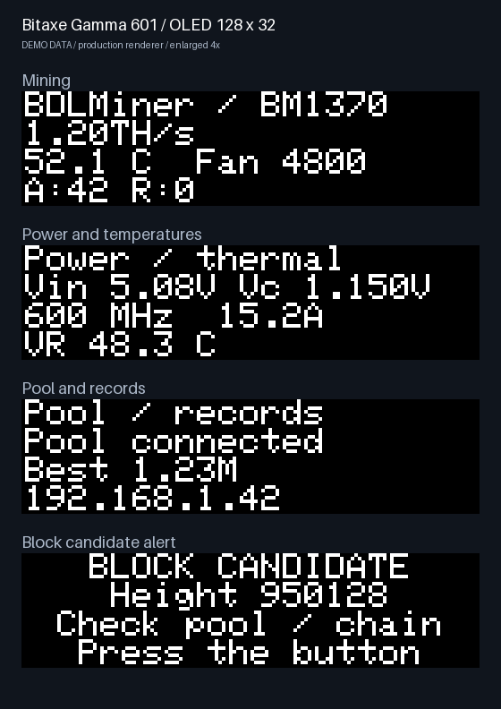

# Bitaxe Gamma 601 — experimental native BDLMiner

This target replaces AxeOS. It drives the single BM1370; it does not use software
SHA on the ESP32 as a substitute. **Since v1.9.8, it is verified mining on a real
Gamma 601** at the stock 525 MHz: about 1.07 TH/s, core 1.145 V and 13 A, ASIC near
52 °C and regulator near 55 °C, over 1,200 accepted shares and none rejected in three
hours. Since v1.9.10, the 550, 600 and 625 MHz profiles are verified too, three minutes
each on the same board at 1150 mV: 1.126, 1.225 and 1.267 TH/s, ASIC up to 58 °C,
regulator up to 71.5 °C, 16.9 A, hardware errors 0.2 %. Profiles above 625 MHz (the
highest ESP-Miner offers at this voltage) are still untested.

### OLED preview (development interface)

The three pages and candidate alert below use the firmware's 128×32 monochrome rendering and font,
enlarged for readability. **All values are fictional demo data**, not hardware
measurements. Press BOOT to switch pages.



The OLED uses four rows of the real 6×8 Font0, with a one-pixel margin at each
side. Rotations are limited to 0°/180° so the available area remains 128×32.
`A` is accepted shares and `R` rejected shares; counters from one million use
SI notation so both remain visible. Long status/setup messages cycle through
complete text portions every three seconds instead of losing their ending.
Unknown power readings show `--`. The block candidate alert is centered and
stays until a button press; it does not claim Bitcoin chain confirmation.

Run `python3 tools/preview_gamma_display.py --check` to exercise the actual Gamma
renderer with LovyanGFX and a 128×32 one-bit native sprite. Omit `--check` to export
PNG previews of normal pages, large counters, faults, setup and the block alert.

## Supported hardware

Only revision **601**, ESP32-S3-WROOM-1 **N16R8** (16 MB flash / 8 MB octal PSRAM),
one BM1370, TPS546D24A/S, EMC2101, 128×32 SSD1306 OLED at 0x3c.

| Function | Pins / bus |
|---|---|
| ASIC UART1 | TX GPIO17, RX GPIO18; 115200 initialization, 1000000 mining |
| ASIC reset | GPIO1, active low |
| I2C0 shared with OLED | SDA GPIO47, SCL GPIO48, 400 kHz |
| TPS546 / EMC2101 / OLED | 0x24 / 0x4c / 0x3c |
| BOOT / screen button | GPIO0 |

Use a regulated **5 V barrel supply rated for at least 4 A** (preferably 25–30 W),
a properly mounted heatsink and the 5 V 4-pin PWM fan. For the 600 MHz profile,
prefer a 5 V / 6 A (30 W) supply for headroom. USB-C provides programming;
USB alone is insufficient for ASIC mining. This target must not be flashed onto a
Gamma Turbo, Hex, Supra, another Gamma revision, or a generic ESP32-S3.

## Build and install

1. Save your AxeOS settings and pool/worker configuration. If you need an exact
   rollback, back up the flash with esptool before erasing it. BDLMiner does not
   import AxeOS NVS settings.
2. Download **`bitaxe-gamma-601-factory.bin`** from the
   [latest release](https://github.com/bdlglua/BDLMinerV2/releases/latest) and
   flash it at **0x0** over USB, or select **Bitaxe Gamma 601 (experimental)** in
   the [web flasher](https://bdlglua.github.io/flash.html).
   Alternatively, build with PlatformIO 6.1.19:

   ```sh
   pio run -e bitaxe-gamma-601
   pio run -e bitaxe-gamma-601 -t upload
   pio device monitor -b 115200
   ```

   If USB is not detected, hold BOOT while reconnecting USB, then release BOOT.
   Factory flashing erases settings/statistics. Existing BDLMiner installations
   can use the matching signed `bitaxe-gamma-601-firmware.bin` for OTA.
   CI artifacts remain unsigned development builds for USB testing.
   A packaged factory image is flashed at **0x0**; the app-only
   `firmware.bin` is not a complete image for offset 0.
3. Connect to `BDLMinerV2-XXXX`, password `MineYourCoins`, and open
   `http://192.168.4.1`. Set WiFi, your payout address/worker, and a web password.
4. Defaults are `public-pool.io:3333`, Stratum V1, suggested difficulty **1024**,
   automatic BDLMiner user agent. The pool must accept BIP310 version rolling
   (>=8 bits); without it the ASIC stays off and the dashboard says so. Below a pool
   difficulty of **16** (a pool taking the miner for a NerdMiner, for instance with
   the `NerdMinerV2` user agent), the ASIC keeps mining since v1.9.8, as ESP-Miner:
   its filter stays at 16, so only those shares are sent. The odds of a block do not
   change, but the pool shows a lower hashrate; a suggested difficulty of 1024 and
   the automatic user agent avoid it.
5. Open the miner's local IP. Check **ASIC · BM1370**, fan RPM, input/core voltage,
   regulator temperature and the physical ASIC temperature. A connected pool alone
   does not mean the ASIC is mining. Establish accepted shares before unattended use.

Do not select Stratum V2 for Public Pool's V1 endpoint. V2 is available through the
existing authenticated V2 client only when the chosen server supports extended
jobs, permits version rolling and supplies an appropriate authority key/target.

To restore AxeOS, use the official Bitaxe/AxeOS USB flashing procedure with the
**601** board configuration or your saved complete flash backup. This changes the
partition layout; do not try to upload an AxeOS app through BDLMiner's OTA form.

## Controls, telemetry and safety

* Since v1.9.7, the firmware defaults to the **stock 525 MHz profile** at
  **1150 mV**, as ESP-Miner (v1.6.1 to v1.9.6 defaulted to an experimental 600 MHz).
  Local Settings > Safety offers **525–800 MHz in 25 MHz steps**; changes apply
  after restart and are included in backups. A profile saved earlier is kept. Invalid
  stored profile values fall back to 525 MHz; API requests outside the available
  profiles are rejected.
* Mining power 10–100% scales the selected profile (minimum 50 MHz); 0 pauses.
  Values 1–9 keep the ASIC off with an explanatory status. Fan speed defaults to
  **100%**; fan controls introduced in v1.9.13 are described below.
  Thermal limiting may reduce the actual frequency below the requested profile.
* Three consecutive ten-second hardware-error windows at **>=2%**, a missing/stalled
  hash counter, or unavailable hardware-error telemetry trigger a reset/power-off and
  one restart at **525 MHz** when running above stock. The fallback stays active across
  pool reconnects, pauses and (since 2.4.2) restarts and updates, as long as the profile
  that failed stays selected; choosing another frequency clears it (to retry the same
  one, select another value, save, then select it again). It never raises voltage.
  At stock, an ASIC that stops answering or whose counter stalls is reset and started
  again automatically, up to **3 times an hour** (the reading at each one is kept as the
  last fault); a fourth failure within the hour stops mining until restart.
  Temperature/fan/supply/sensor faults keep their latched shutdown behavior and never
  use this retry path.
* The dashboard shows requested/actual frequency, measured hardware-error percentage
  (unavailable until a complete window), fallback state and its reason. Rates still
  come from the physical hash counter, not from clock settings. **Overclock profiles,
  including 600 and 800 MHz, have not been validated on a physical Gamma 601.**
  The 800 MHz setting does not guarantee stability at the fixed 1150 mV; no voltage,
  current, temperature or fan limits are raised to reach the requested frequency.
* BOOT short press cycles the three compact OLED pages; a long press follows the
  existing reset/setup behavior. OLED rotation maps 0/1 to normal and 2/3 to 180°.
* No ASIC power during provisioning. Startup checks device identities and verifies
  volatile PMBus writes with ESP-Miner's values and encodings. A number read back is
  compared as a value (the regulator may store it with another exponent, or rounded
  to its resolution); a setting that does not hold is named in the log. VOUT
  warning/fault/margin registers are programmed as ratios of `VOUT_COMMAND`, while
  command/min/max registers use absolute voltage. **No regulator NVM/STORE commands
  are sent.**
* Without its 5 V barrel supply (USB only), the regulator does not answer: the
  dashboard shows *Regulator or sensors not found: plug in the 5V supply* and the
  setup is tried again every 5 seconds. Before powering the ASIC, the firmware waits
  for an input of at least **4.8 V** and a turning fan, then clears the regulator's
  latched faults (an undervoltage from the missing supply).
* The user thermal limit (default 65°C, at most 68°C since 2.3.4 so that it pauses
  before the latching 70°C stop; a higher saved value is lowered to 68°C) pauses mining. Since v1.9.10 an ASIC board has
  no 50% / 25% steps below it (each power change restarted the ASIC, which then cooled
  at once: at 600 MHz a Gamma restarted every 40 s at 55 °C), and once hot it stays
  paused at least two minutes, its own sensor being silent while it is off. Independent
  hard interlocks stop at **70°C ASIC**, **90°C regulator**, lost sensors, fan
  <500 RPM, input below **4.6 V** while mining (a 5 V supply sags under load; the
  regulator itself stops at 4.5 V) or above **5.5 V**, core voltage outside
  **1.0–1.25 V** while powered, output current >=30 A, or a regulator fault. As in
  ESP-Miner, the regulator faults are `STATUS_WORD` OFF (while powered), VOUT_OV,
  IOUT_OC, VIN_UV and TEMP; its other bits also report warnings or stay latched
  (OTHER) and do not stop mining, the measured limits covering them. Hard limits
  remain active even if the user temperature setting is disabled. Faults latch
  until restart, and the log gives every reading at the fault (status word, input
  and core voltage, current, temperatures, fan). The last one is kept across
  restarts: logged at boot and shown on the dashboard's ASIC tile, with its date.
* The ASIC diode only reads once the BM1370 routes it (analog mux, register 54h):
  from power-on until then it is ignored (a real Gamma read 106 °C there on a 25 °C
  board) and the board's EMC2101 temperature stands in. Afterwards, a diode fault
  (70 °C or more, or no reading) must hold for **three readings in a row**, 0.75 s
  while mining, before it stops the ASIC: a real overheat takes far longer, and one
  false reading no longer stops it until restart.
* When pool work disappears (a reconnection, a failover), the ASIC keeps running on
  its last job for up to **60 seconds**, its results discarded, instead of being
  powered off and started again (about 9 s of *Initializing BM1370* and PLL ramp at
  each reconnection). The dashboard shows *Waiting for pool* meanwhile; a pool that
  stays away longer powers it off. Safety pauses (power 0, heat, faults, OTA, the
  supervision lease) still stop it at once. Since 2.3.2 the main loop renews that
  lease on every pass and it lasts 10 s (3 s before): the 2-2.5 s that a TLS
  handshake can hold the loop no longer expires it, which also restarted the ASIC.
* Startup waits 500 ms for core power stabilization, then ramps the PLL in
  6.25 MHz steps spaced by 100 ms, following ESP-Miner. Fan, voltage/current and
  regulator temperature are sampled throughout startup after the power-good grace
  period; the ASIC diode is required once its mux/conversion has settled. The ramp
  responds to live power limits and stops on faults, stale work or expired permission.
* Reset is asserted **before** the I2C power-off command. On a failed I2C shutdown,
  the dashboard explicitly reports a shutdown fault; remove power and investigate.
* The ASIC task checks the existing three-second supervision lease and OTA state.
  Pauses/connection loss/clean jobs invalidate outstanding work and stop the ASIC.
  Sensor sampling continues during ordinary pauses so cooldown can be observed.
* Returned nonces are CRC checked, mapped to a bounded work-slot cache, screened
  for duplicates and independently double-hashed on the ESP32 before submission.
  Negotiated version masks apply to both V1 and V2; stale generations are discarded.
* Hashrate comes from the ASIC's 0x8c counter in units of 2^32 hashes, not from the
  configured clock. Counts, rate windows and dashboard history support TH/s.
  The first counter response establishes the baseline; missing replies or a stalled
  counter stop mining.
* Local difficulty records are sampled from ASIC results (minimum difficulty 16),
  rather than all difficulty-1 candidates. Pool shares still use the assigned target.
* Automatic GitHub installation defaults to **check/offer** on this experimental
  target. Existing published releases do not acquire a Gamma binary retroactively.

## Fan control (v1.9.13)

In the local **Settings > Safety > Cooling**, select **Manual** (30–100%) or
**Automatic**. Saving changes applies them without restarting the ASIC. The
mode and manual percentage are included in settings backups. Existing records
retain **manual 100%**, so installing this code does not reduce their cooling.
This feature is included in [v1.9.13](../releases/v1.9.13.md).

The dashboard shows the last verified PWM command, measured RPM, control mode and
any cooling override. The EMC2101 has 64 duty levels, so a requested 40% becomes
a displayed 41% after rounding up. A percentage is a control command, not an
RPM target. An unverified controller command is reported as unknown.

- Startup, stopped ASIC and an unavailable temperature force **100%**.
- At the default thermal limit, **60 °C ASIC** or **80 °C regulator** forces
  full cooling. Both must cool by 5 °C before that override clears, including
  across ordinary mining pauses. A lower user thermal limit moves the ASIC
  cooling threshold to 5 °C below that limit. Disabling the user limit retains
  the 60/80 °C cooling override and the independent hard shutdowns.
- Automatic mode starts at 30% below 40 °C ASIC / 60 °C regulator and rises
  to full at those cooling thresholds. Increases are immediate; reductions
  wait at least five seconds between changes. The ASIC curve shifts down
  when a lower user temperature limit is selected.
- PWM writes are read back. A write/read-back failure asserts ASIC reset,
  requests regulator shutdown and full fan speed, and latches the fault. The
  existing <500 RPM stop remains active.

The worker owns the I2C transactions; the web handler only updates one atomic
configuration. Unchanged PWM commands are not repeatedly rewritten.
See the [implementation and validation review](../audits/2026-11-01-gamma-fan.md).

## Validation before calling this support stable

Host tests execute the native hardware backend with simulated I2C/UART, including
startup and failed regulator writes, fan/sensor/temperature faults, reset and power
off, safety-lease expiry and old jobs. Separate tests cover known wire vectors,
CRC resynchronization, PLL bounds, PMBus numeric formats, 64-bit rate accounting,
independent SHA-256d verification, BIP310 and V2 rolling masks. Browser tests cover
ASIC diagnostics, stopped-ASIC status, missing telemetry and TH/s chart axes.

Still required on a physical 601: verify pinout and readbacks, cold boot with barrel
power/USB only, real fan tach behavior, diode/VR temperatures against AxeOS, pool
negotiation and accepted shares, sustained actual counter-derived hashrate, normal
thermal throttling/cooldown, power-supply sag, OTA pause and USB recovery. Never
induce overheating or a fan fault under load for testing; use controlled sensor/HAL
fault injection instead.

## Attribution and references

The 600 MHz controls, automatic fallback and regulator/startup corrections ship
in v1.6.1. They are not in v1.6.0. Stock 525 MHz remains selectable.
Profiles above 600 MHz ship in v1.6.2 and are not included in v1.6.1.

The reference comparison and fixes after v1.6.0 are recorded in
[the Gamma integration review](../audits/2026-10-27-gamma-reference.md).

The BM1370 register sequence, ASIC framing/CRC/PLL conventions, stock board 601
configuration and TPS546/EMC2101 register references were adapted from
[bitaxeorg/ESP-Miner](https://github.com/bitaxeorg/ESP-Miner/tree/bb4fd0c7e589858bbeef00ec89342216c1510671),
revision **bb4fd0c7e589858bbeef00ec89342216c1510671** (GPL-3.0).
See its `components/asic/bm1370.c`, `asic_common.c`, `bm_job_packet.c`, `pll.c`,
`main/device_config.h`, `main/power/TPS546.c`, and `main/thermal/EMC2101.c`.
Hardware reference: [bitaxeorg/bitaxeGamma](https://github.com/bitaxeorg/bitaxeGamma),
`bitaxeGamma601-schematic.pdf` and the revision-601 configuration. BDLMiner remains
GPL-3.0; this integration is not an official Bitaxe/AxeOS release.
